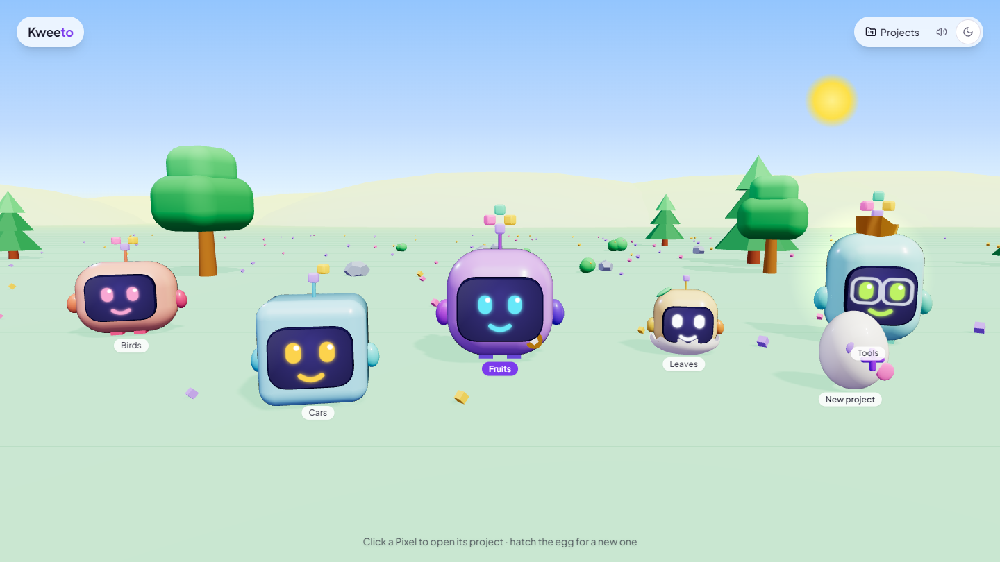
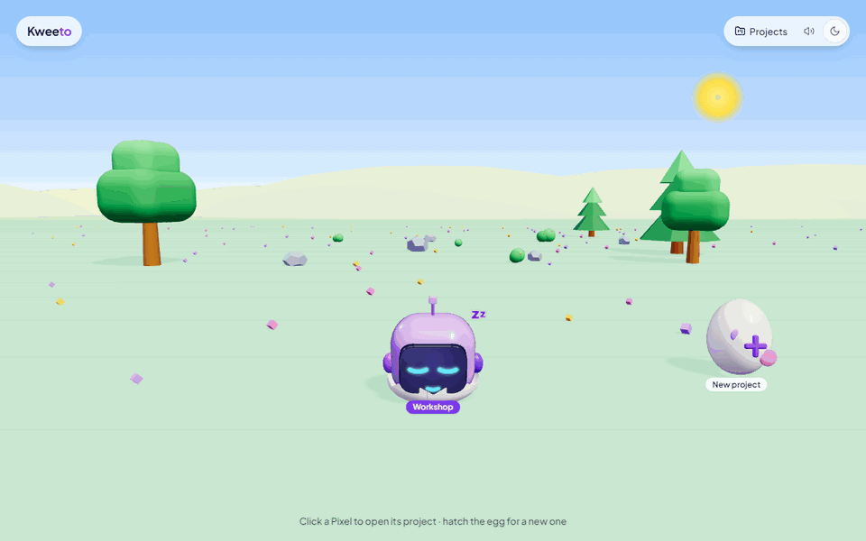
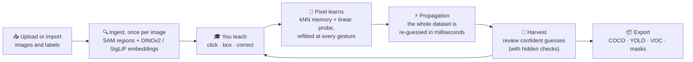
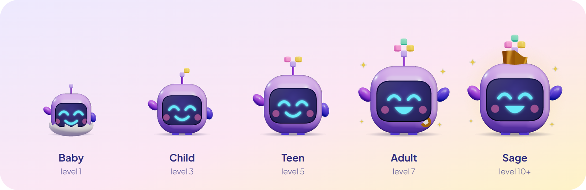
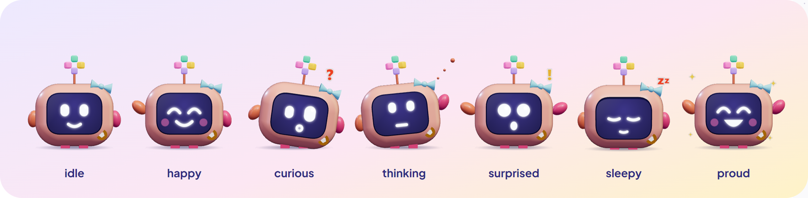

<div align="center">

<picture>
  <source media="(prefers-color-scheme: dark)" srcset="assets/playground-dark.png">
  
</picture>

# Kweeto

### Don't label images. **Teach a Pixel.**

Image annotation for computer vision that feels like **mentoring an apprentice**.<br>
Every correction you make ripples through the whole dataset, and you can *see* it happen.


[**Quick start**](#quick-start) · [**How it works**](#how-it-works) · [**Meet Pixel**](#meet-pixel) · [**Results**](#does-it-actually-learn) · [**Docker**](#-docker-recommended) · [**Docs**](#documentation) · [**Changelog**](CHANGELOG.md)

</div>

---

## Why Kweeto?

Most annotation tools compete on *automation*. Kweeto competes on the **annotator's experience**: you teach, an apprentice
called **Pixel** learns, and every lesson visibly pays off.

| | |
|---|---|
| 🎓 **Teach, don't tick boxes** | Click an object and SAM draws a tight box around it. A few examples per class and Pixel starts guessing, as dashed boxes you accept, reject or relabel. |
| ⚡ **Every gesture ripples** | After each correction the *whole* dataset is re-guessed. The images that changed their mind are counted, and attributed to the gesture that caused them. |
| 🌾 **Harvest, with hidden traps** | Confident guesses are reviewed in groups, as a hunt for mistakes. Each group hides a deliberately wrong check, so rubber-stamping gets caught. |
| 🙋 **Pixel asks, too** | It requests more examples of weak classes, points at clusters it has never seen and asks you to separate classes it confuses. |
| 🤝 **Honest by design** | Pixel learns *only* from what you confirmed (no feedback loop) and never shows a made-up percentage: just *sure / maybe / guess* and how often its guesses were right lately. |
| 🏋️ **Train a real detector** | When you have finished enough images, train a full LibreYOLO detector (YOLOv9 / YOLOX) in the background, for minutes or a whole night, with honest scores on images it never saw. Download it as `.pt` or ONNX, or use it in Kweeto: Pixel takes it as a **second opinion** on its guesses. (Pixel works out while it trains.) |
| 📥 **Bring your dataset** | Already labelled, even half of it? Import COCO, YOLO, Pascal VOC, Label Studio or CVAT: your boxes become examples and Pixel starts out already taught. |
| 🩺 **Hunt label errors** | Pixel compares every box with all the others and says it plainly: *"This box is 'bolt', but 12 'nut' look more like it."* Plus near-duplicate images, odd sizes and class balance. |
| 📈 **See it learn** | At the end of each lesson: how often Pixel was right at the start and at the end, and the images where it changed its mind. |
| 📦 **Export anywhere** | COCO, YOLO (+ segmentation), Pascal VOC, CSV and PNG masks in one zip, with a reproducible train/val/test split. |



## How it works



The expensive vision work happens **once per image**, in the background. Learning and prediction are cheap, so the
feedback after every gesture is quick, with **no network training** and no GPU required. The details are in
[How the engine works](docs/architecture.md#how-the-engine-works).

## Meet Pixel

Every project hatches **its own Pixel**: its own name, colour (the whole interface takes it), body shape, eyes and
accessory. It **grows up with the examples you teach it**, and its mood follows what the model is actually doing.

<p align="center">
  
</p>

<p align="center">
  
</p>

Real 3D bodies, built with three.js: they breathe, blink, follow your cursor with their eyes, hop when a guess is right,
squish when poked and tell you *true* fun facts about their project. Pixels meet and chat in the **playground** (the
home page), and the egg in the corner hatches a new project. Dark mode brings a night sky, and 8-bit sounds are
synthesised in the browser, one voice per Pixel.

## Training a detector

Pixel's everyday learning (kNN memory + linear probe) reacts in milliseconds. The **Training** page adds the other
kind: a full object detector trained with [LibreYOLO](https://github.com/LibreYOLO/libreyolo) (MIT) on your project,
started on command and left running as long as it needs, overnight if you like.

- **Data**: only the images you *finished* in a Lesson ("Save & next"): there every object is boxed, so everything
  else is genuinely background. A fixed 20% is held out and never trained on: the mAP you see is measured there.
  Pixel's own guesses are never used (no feedback loop).
- **Models** (permissive code and weights only), fine-tuned from their COCO-pretrained weights, downloaded once from
  the LibreYOLO Hugging Face organisation: CNNs **YOLOv9** t / s / m (MIT), **YOLOX** n / s and **RTMDet** t / s, and
  detection transformers **D-FINE** n / s, **DEIM** n / s and **RT-DETRv2** r18 / r34 (Apache-2.0; RT-DETRv2 runs at
  640 px). Each was checked end to end here (training, ONNX export, inference). LibreYOLO has more trainable families:
  the Training page lists them, and one is added with a few lines in a plugin once its license is checked
  ([Extending Kweeto](docs/extending.md)); some are non-commercial or GPL and are deliberately not offered.
- **Runs** go in a separate low-priority process: live epoch, ETA and learning curve, **stop** at any time (the best
  epoch so far is kept), **resume** later, one run at a time. Training uses CUDA or Apple MPS when PyTorch has them,
  otherwise the CPU (a long night for the bigger models); the result is exported to ONNX and runs on any execution
  provider.
- **Download** the best checkpoint as `.pt` (LibreYOLO) or `.onnx`, together with its scores.
- **Use in Kweeto**: the detector's boxes appear on the image page (views Pixel / Detector / Both), and Pixel takes
  it as a **second opinion**. The detector looks once at every image still to annotate; where it sees an object that
  Pixel's scan missed, that spot becomes a new candidate region. Where its box matches one of Pixel's guesses, Pixel
  gets surer if they agree on the class and humbler if they don't; where it saw nothing, a bit humbler. Pixel never
  proposes anything on the detector's word alone (it still needs familiar examples) and still learns only from your
  boxes. The Lesson shows the detector's opinion next to each guess ("Detector agrees · 0.82"). On by default once a
  detector is in use, switchable on the Training and Engine pages. In the benchmark with real models (synthetic scenes,
  `light` profile, YOLOv9-t trained on 15 finished images) held-out F1 went from 0.94 to 0.99 and from 0.91 to 0.98
  (two seeds), mostly because the detector found objects the scan had missed. Where Pixel was already perfect (fake
  embedder) it cost one extra wrong guess on 30 held-out images at one checkpoint, then nothing.

## More features

<details>
<summary><b>Every feature in detail</b></summary>

- **Projects**: one per dataset, each with its own images, classes, engine profile and **its own Pixel** (name, colour,
  body shape, eyes, accessory; the whole UI takes its colour). Switch from the sidebar; delete single images, a
  selection from the Gallery, or a whole project. Nothing is created by default: the first start shows an empty
  playground with an egg to hatch the first project.
- **The playground** (Home, full screen, nothing else): a 3D field (perspective camera, parallax with the mouse, trees
  and rocks the Pixels walk behind; a night sky in dark mode) where every project's Pixel wanders, meets the others and
  chats, always with *true* facts about its project ("I know 3 classes", "Wow, level 7!"). Hover a Pixel for its card,
  click it to open its project (its overview is at `/overview`, with the usual sidebar); the egg hatches a new project.
- **Pixels grow up** with their level (= the examples you taught): baby (still in its egg shell) → child → teen →
  adult (badge) → sage (crown), with a celebration at each new stage. Body language follows the mood (hops when
  happy, startles, breathes slowly when sleepy, puffs up when proud, tilts its head when curious).
- **Export** (Data → Export): one zip with **COCO** (boxes + instance polygons), **YOLO** (detection, plus
  `yolo-seg/` segmentation, `data.yaml` ready for Ultralytics), **Pascal VOC**, **CSV** and **PNG masks** (semantic +
  instance), optional images, reproducible train/val/test split, empty finished images kept as negatives. Masks are
  drawn by the segmenter inside your confirmed boxes (cached, box rectangle as a fallback; the zip's README says how many
  of each), so check them before training a segmentation model.
- **Import** (Data → Import): bring a dataset you already labelled, even only half of it: **COCO**, **YOLO**
  (`labels/*.txt` + `data.yaml`/`classes.txt`, boxes or polygons), **Pascal VOC**, **Label Studio** (full or JSON-MIN
  export) and **CVAT** ("CVAT for images" XML). Drop the folder or its zip: Kweeto recognises the format and shows
  what it found (classes, matched images, annotations without an image) before importing anything. Imported boxes are
  examples like the ones you draw, so Pixel starts out already taught; images without labels become images to teach.
  Images already in the project are matched by content or file name and keep your boxes; photos stored with an EXIF
  rotation get their boxes rotated with them; COCO "crowd" boxes and Label Studio predictions are not imported.
- **Health** (Data → Health): class balance, near-duplicate images (same shot resized or recompressed) and the hunt
  for label errors. Pixel compares each of your boxes with all the others (leave-one-out, same embeddings it learns
  from) and tells you plainly: *"This box is 'bolt', but 12 'nut' you taught me look more like it than any other
  'bolt'. Can you check it?"*, with the look-alikes next to it. It also flags boxes far bigger or smaller than their
  class, objects boxed twice or with two classes, and slips of the mouse. One click relabels (a correction Pixel learns
  from at once), deletes, or keeps the box ("It's right" is remembered).
- **Lesson recap, before / after**: "End lesson" shows how often Pixel was right at the start of the lesson and at
  the end (guesses you judged *before* it learned from them: its real, prospective score), what you did, how many
  images changed because of it, and the images still to teach where it changed its mind (its guesses then and now).
  The Overview links the last one.
- **Sounds**: 8-bit cues synthesised in the browser (no audio files), each Pixel with its own voice (younger =
  higher). One click to mute, next to the theme toggle or in Engine → Appearance.
- **Upload** a folder of images; embeddings are computed in the background.
- **Lesson**: **click an object and SAM draws a tight box around it**; hand-drawn boxes snap to the object. Keyboard shortcuts for everything;
  Pixel's guesses appear as dashed boxes that you accept, reject or relabel.
- **A big, zoomable canvas**: the Lesson uses the whole screen (`F` = focus mode), wheel zoom up to 16× with a minimap,
  Space+drag to pan. Click a box to select it, then drag it, resize it from its handles or change its class from the
  little toolbar next to it (or `1-9`); undo/redo with `Ctrl+Z`/`Ctrl+Y`, `H` hides Pixel's guesses.
- **Two learners**: a kNN memory (literal, instant) blended with a linear probe (generalises); when they disagree Pixel lowers its confidence.
- **Propagation ⚡**: every gesture re-evaluates the whole dataset; the images that change are attributed to the gesture that caused them.
- **Harvest**: confident guesses grouped by originating lesson ("From your correction: Nut → Washer"). Flag the wrong ones and approve the rest.
  Each group hides a deliberately wrong check: approve it and Pixel will tell you.
- **Apprentice Questions**: Pixel asks for more examples of weak classes, points out clusters of never-seen images and asks you to separate classes it confuses.
- **Similar images** search and a gallery with filters.
- **Pixel** is a 3D character (SVG on small sizes and as a fallback) whose mood follows what the model is actually doing: its eyes follow your cursor,
  it jumps when it guesses right, celebrates combos and level-ups with pixel confetti, and tells you (true) fun facts when you poke it.
- **Light and dark themes** (or follow the system), drag & drop upload, keyboard-first lesson.
- **Command palette** (`Ctrl K` / `⌘K`, or "Search…" in the sidebar): go to any page, open a project, find an image
  by file name, switch theme or sounds, share Pixel's card.
- **Pixel's card**: a 1200×630 PNG of the project's Pixel with its level, stage and *real* numbers (examples taught,
  images, classes, ⚡ mind changes, first vs latest guesses): download it, copy it or share it (Overview, sidebar, palette).
- **Accessible**: skip link, labelled landmarks and buttons, visible keyboard focus, dialogs that keep the focus.
  Every project colour is adjusted for WCAG AA contrast (4.5:1) in both themes: text in the accent colour is darkened
  or lightened as needed, and buttons switch to dark text on light colours such as amber or lime. The Lesson works
  without a mouse: `N` adds a box, arrows move it, `Ctrl`+arrows resize it, `Tab` walks through the boxes, `G` through
  Pixel's guesses (`A` / `X` accept or reject the highlighted one), and a screen reader hears every step.

</details>

## Quick start

### 🐳 Docker (recommended)

```bash
docker compose up -d          # builds the image the first time, then open http://localhost:3000
```

One container, one port, your data kept in volumes.

<details>
<summary><b>Docker options</b></summary>

One container runs both servers; only port 3000 is published, **on `127.0.0.1` only** (Kweeto has no
authentication: see [SECURITY.md](SECURITY.md)), and the frontend forwards `/api` and `/files` to the
backend inside the container. Two named volumes keep everything across updates: `kweeto-data` (projects, images,
exports, mounted on `/data`) and `kweeto-models` (vision models downloaded on first use, on `/models`).

- **Light image** without PyTorch (~400 MB instead of ~2 GB; test embedder + simple segmenter, good for trying the UI):
  `KWEETO_TORCH=none docker compose up -d --build`.
- **Other port**: `KWEETO_PORT=8080 docker compose up -d`.
- Inference in the container uses ONNX Runtime on the CPU. For an NVIDIA GPU (untested), build with
  `--build-arg ORT_PACKAGE="onnxruntime-gpu[cuda,cudnn]"` and run with `--gpus all`.
- **Without Compose**: `docker build -t kweeto .` then
  `docker run -d -p 127.0.0.1:3000:3000 -v kweeto-data:/data -v kweeto-models:/models --name kweeto kweeto`.
- Behind a TLS-intercepting proxy, set `KWEETO_TRUSTSTORE=1` (and `HTTPS_PROXY`) in `docker-compose.yml`.
- To bring an existing project in, copy its `backend/data/projects/<id>/` folder into the volume
  (`docker cp <folder> kweeto:/data/projects/`) and restart the container.

Also handy: `docker compose logs -f` to follow the logs and `docker compose down` to stop (your data stays in the volumes).

</details>

### 💻 Run it locally

Requirements: Python 3.10+ (3.11 recommended, see `backend/.python-version`) and Node.js 22 LTS.

```powershell
.\scripts\setup.ps1          # Windows. add -Light to skip torch
.\scripts\dev.ps1            # add -Fake for the fake embedder (data in backend/data-fake)
```

```bash
./scripts/setup.sh [--light]  # macOS / Linux / Git Bash
./scripts/dev.sh [--fake]     # both servers in one terminal, Ctrl+C stops both
```

On Windows you can also **double-click `scripts\dev.bat`**.

<details>
<summary><b>Step by step, by hand</b></summary>

#### 1. Backend

```powershell
cd backend
python -m venv .venv
.\.venv\Scripts\Activate.ps1          # macOS/Linux: source .venv/bin/activate
pip install -r requirements.txt       # includes torch (CPU) and transformers: takes a few minutes
uvicorn app.main:app --reload --port 8000
```

On first start SigLIP (`google/siglip-base-patch16-224`, about 800 MB) is downloaded from Hugging Face.
Interactive API docs: http://localhost:8000/docs ([endpoint list](docs/api.md)).

**Without torch** (to work on the UI quickly) use a fake pixel-based embedder:

```powershell
pip install fastapi "uvicorn[standard]" sqlalchemy pillow numpy python-multipart faiss-cpu
$env:KWEETO_EMBEDDER="pixels"; uvicorn app.main:app --reload
```

Switching between the fake and real embedders in the same database triggers a full re-embed (see [Engine profiles](docs/engine-profiles.md)); a separate `KWEETO_DATA_DIR` is faster.

#### 2. Frontend

```powershell
cd frontend
copy .env.local.example .env.local    # NEXT_PUBLIC_API_URL=http://localhost:8000
npm install
npm run dev
```

Open http://localhost:3000.

</details>

### 🎬 Your first lesson

**No images at hand?** On the first start, click **Try the demo** (also on the Projects page, or `Ctrl K` → "Try the
demo project"): a demo project opens with 36 synthetic images of tomatoes, limes and pipes, three classes and a fast
engine, and a short guided tour takes you through your first lesson. Nothing is pre-labelled: Pixel's first guesses
usually appear after the very first image you teach (about half a minute after the click, measured on a laptop).

With your own images:

1. **Upload**: pick a folder of images (or **Import** a labelled dataset). Pixel computes the embeddings in the background.
2. **Home**: create the classes (e.g. Bolt, Nut, Washer).
3. **Lesson**: draw boxes with the active class (keys `1-9`), `⏎` saves and moves on.
   After a few examples per class dashed guesses appear: `A` accepts them, `X` rejects them. Click a box to select it and
   change its class (toolbar next to the box or `1-9`), move it or resize it. Wheel = zoom, Space+drag = pan, `0` = fit.
   The ⚡ counter shows how many images Pixel changed its mind about thanks to you.
4. **Harvest**: groups of confident guesses. Click a thumbnail to flag it as wrong (and say what it really is), then "Approve the rest".
5. **Questions**: answer Pixel's doubts about concepts.

## Does it actually learn?

The repository ships a **learning benchmark**: a simulated teacher works through the real API on synthetic scenes with
known ground truth (piles of touching objects, broken pipes, look-alike classes) and is scored on a held-out set it never
sees. With the quick test embedder, held-out **F1 goes from 0.70 to 0.99 in 25 lessons**, in about 20 seconds, and a
regression test (`tests/test_learning.py`) keeps that curve from silently getting worse.

Synthetic scenes are easier than photographs and the teacher is simulated, so treat the curve as a signal, not a promise.
[Measure your own labelled data](docs/architecture.md#measuring-it-the-learning-benchmark) with one command (COCO input is supported).

---

## Documentation

| | |
|---|---|
| [Architecture](docs/architecture.md) | repository layout, how the engine learns, the learning benchmark |
| [Configuration](docs/configuration.md) | environment variables, scan speed, troubleshooting |
| [Engine profiles and GPU](docs/engine-profiles.md) | `light` / `balanced` / `accurate` / `custom`, ONNX Runtime and execution providers |
| [Extending Kweeto](docs/extending.md) | write a plugin: embedder, segmenter, learner, detector family |
| [HTTP API](docs/api.md) and [database schema](docs/database.md) | every endpoint and table |
| [Model and dependency licenses](docs/licenses.md) | everything Kweeto downloads or depends on is Apache-2.0 compatible |
| [Contributing](CONTRIBUTING.md) | tests, lint, pull requests |

## Known limitations

- Pixel can only propose objects that have a candidate region: the ingest scan is the ceiling (the benchmark measures it).
  Objects you draw by hand are always learned, but similar missed objects elsewhere stay missed until a re-scan with a better segmenter.
- "Save & next" in a Lesson means *every object of the known classes is boxed here*: unboxed regions become "not an object".
  Saving an image with objects left out teaches the wrong thing (weakly: clutter has half weight). When in doubt, skip.
- Fragments are merged two at a time (an object broken into three pieces is not proposed whole yet).
- The automatic scan costs seconds per image on a CPU (see [the profile table](docs/engine-profiles.md)): fine in the background for hundreds of
  images; for thousands pick `light` or use a GPU.
- With SAM v1 models (`light`, `accurate`) a click on an object inside a pile may select the whole pile (the
  "whole object" heuristic); SAM 2 (`balanced`) separates them better. Draw a box in that case.
- Projects created before the segment-based scan keep their old grid regions until you press **Re-scan** in the Engine page.
- Single user, no authentication: meant to run locally.

## Vibe-coded, openly

**This project is entirely vibe-coded.** Every line of it (backend, frontend, 3D Pixels, Docker setup, tests and this
README) was written by an AI coding assistant ([Claude Code](https://claude.com/claude-code)) in conversation with a
human, who provided the idea, the product decisions and the taste, and judged the results by running the app.

What that means for you:

- **Treat it as a working prototype, not audited software.** Expect rough edges, and read the code before you rely on
  it for anything important. It has not had a security review: it is meant to run locally, for a single user.
- **What keeps it honest:** an automated test suite (unit tests, an end-to-end API test, a learning regression test) and the
  learning benchmark described above, so changes to the engine are judged by measurements, not by feel.
- **Bug reports and PRs are welcome**, whether they were written by hand or with an assistant: see
  [CONTRIBUTING.md](CONTRIBUTING.md), and [SECURITY.md](SECURITY.md) for vulnerabilities.

## License

Kweeto is released under the [Apache License 2.0](LICENSE) (see also [NOTICE](NOTICE)). The models it downloads
keep their own licenses, all Apache-2.0 compatible: see [Model and dependency licenses](docs/licenses.md).

---

<div align="center">

**Kweeto**: single user, no authentication, meant to run on your own machine.<br>
*Teach it once, watch it ripple.*

</div>
